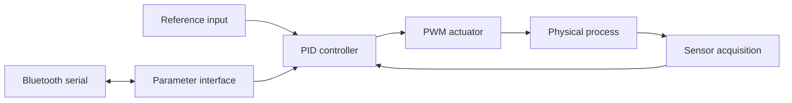

# PID Module — ESP32 Control Toolkit

**An embedded control project combining sensor acquisition, PWM actuation, PID logic, and Bluetooth communication.**

## Contents

- [Overview](#overview)
- [System components](#system-components)
- [Control architecture](#control-architecture)
- [Hardware interface](#hardware-interface)
- [Requirements](#requirements)
- [Setup](#setup)
- [Important implementation status](#important-implementation-status)
- [Safety and validation](#safety-and-validation)
- [License](#license)

## Overview

PID_MODULE is an ESP32-oriented embedded project that brings together input acquisition, PWM output, a PID-controller class, timer-based scheduling, and Bluetooth serial communication.

The source includes separate modules for ADC, pulse, PWM, actuator output, and PID calculations. It is a prototype/control framework; the currently committed sketch does not execute a complete closed-loop PID cycle by default.

## System components

| Module | Responsibility |
|---|---|
| `leitura_adc_lib` | Analog input acquisition |
| `leitura_pulsos_lib` | Pulse measurement |
| `leitura_pwm_lib` | PWM signal measurement |
| `acionamento_pwm_lib` | PWM output actuation |
| `PID_lib` | PID control calculation |
| `BluetoothSerial` | Parameter communication |

## Control architecture

This is the intended control architecture represented by the available modules. The actual feedback calls are currently commented out in the timer callback.

## Hardware interface

The sketch defines these ESP32 pins:

| Signal | GPIO |
|---|---:|
| PWM output `PIN_Y` | 23 |
| Sensor input `PIN_H` | 2 |
| Reference input `PIN_R` | 4 |

Confirm the board, electrical levels, sensor output type, and external circuitry before wiring hardware.

## Requirements

- ESP32 development board with Bluetooth support
- Arduino IDE or compatible ESP32 toolchain
- Sensor and actuator hardware matching the selected input/output modes
- Libraries and ESP32 Arduino core compatible with the APIs used by the sketch

The timer and LEDC APIs in the source are version-sensitive. Check compatibility with the installed ESP32 Arduino core before compiling.

## Setup

1. Clone the repository.
2. Open `PID_MODULE.ino` in the Arduino IDE.
3. Install/select ESP32 board support.
4. Inspect the files under `src/` and verify the hardware connections.
5. Select the correct board and serial port before compiling and uploading.

## Important implementation status

In the current sketch, the timer callback sends Bluetooth parameters, while the sensor reads, PID calculation, and PWM update are commented out. The main loop currently processes incoming Bluetooth data.

Therefore, do not treat the committed sketch as an active closed-loop PID controller without completing and validating that execution path.

## Safety and validation

Test with actuator power disconnected or safely limited first. Confirm signal ranges, timer behavior, interrupt safety, and output saturation before connecting a physical plant.

## License

No `LICENSE` file is currently included. Unless a license is added, reuse and redistribution permissions are not granted by this repository.
